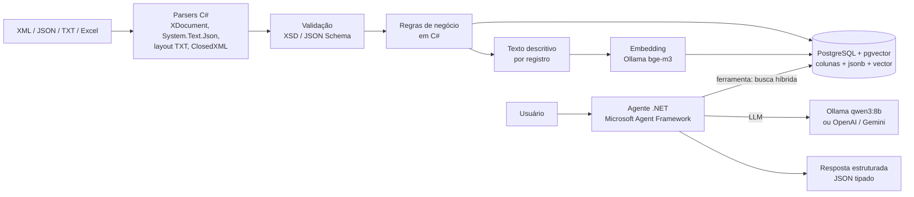

# Ollama (LLM local) vs. OpenAI e Gemini

## Agentes em C# .NET para análise de documentos estruturados com pgvector

> Estudo consolidado em 28/10/2026. Versões de pacotes verificadas no NuGet nessa data. Os trechos de código C# deste documento foram compilados com .NET 10.


---

## Resumo executivo

- **Para o seu cenário, o Ollama é a escolha recomendada para começar e muito provavelmente para produção.** Documentos bem estruturados (XML, JSON, TXT posicional/delimitado, Excel) com regras bem estabelecidas pedem que o **parsing e as regras sejam código C# determinístico**. O LLM fica só com a parte de linguagem: entender a pergunta, escolher a ferramenta certa e explicar o resultado. Para isso, modelos locais de 8B a 14B são suficientes.
- **O .NET suporta Ollama no mesmo nível que OpenAI e Gemini.** Com `Microsoft.Extensions.AI` (`IChatClient` e `IEmbeddingGenerator`) e o Microsoft Agent Framework (`Microsoft.Agents.AI`), o mesmo código roda nos três; só muda a linha que cria o cliente.
- **Embeddings não substituem SQL.** Valores exatos (número da nota, CNPJ, datas, totais) se buscam com `WHERE`; embeddings servem para campos de texto livre, similaridade e para recuperar o texto das regras.
- **Escolha o modelo de embedding uma vez.** Trocar de modelo (ou de provedor) obriga a reprocessar todos os vetores, porque dimensões e espaços vetoriais são incompatíveis.
- **Use nuvem quando** precisar de raciocínio de ponta sobre muitos documentos ao mesmo tempo, texto ambíguo, contexto gigantesco, ou não tiver hardware.

---

## 1. O que está sendo comparado

O **Ollama não é um modelo**: é um runtime que baixa e executa modelos de pesos abertos (Llama da Meta, Qwen da Alibaba, Gemma do Google, Mistral, DeepSeek, gpt-oss da OpenAI) na sua máquina ou servidor, expondo uma API HTTP em `http://localhost:11434` (inclusive uma API compatível com a da OpenAI em `/v1`).

**OpenAI e Gemini** são serviços na nuvem que expõem modelos proprietários por API, cobrados por token. Ambos têm versões empresariais: Azure OpenAI (Microsoft) e Vertex AI (Google).

A comparação justa é: **modelo aberto rodando localmente** vs. **modelo de ponta na nuvem**.

---

## 2. Comparativo lado a lado

| Critério | Ollama (local) | OpenAI | Gemini |
|---|---|---|---|
| Custo | Grátis por token; custo é hardware e energia | Pago por token de entrada e saída | Pago por token; camada gratuita com limites |
| Privacidade | Dados nunca saem da sua rede | Dados vão ao provedor | Dados vão ao provedor; Vertex permite escolher região |
| Qualidade / raciocínio | Boa em 8B–32B; abaixo dos modelos de ponta em tarefas complexas | Estado da arte | Estado da arte, forte em multimodal |
| Janela de contexto | Configurável (`num_ctx`), limitada pela memória | Centenas de milhares de tokens | Até ~1M tokens |
| Latência | Sem rede; depende da GPU/CPU | Rede + fila do provedor | Rede + fila do provedor |
| Escalabilidade | Você escala (mais GPUs/instâncias) | Elástica, com rate limits | Elástica, com rate limits |
| Offline | Sim | Não | Não |
| Tool calling | Sim, em modelos com a tag `tools` | Muito robusto | Muito robusto |
| Saída estruturada (JSON Schema) | Sim | Sim | Sim |
| Embeddings | Sim (`bge-m3`, `nomic-embed-text`, etc.) | Sim (`text-embedding-3-*`) | Sim (`gemini-embedding-001`) |
| Operação | Você mantém tudo | Zero infraestrutura | Zero infraestrutura |
| SLA | Comunidade | Empresarial (Azure OpenAI) | Empresarial (Vertex AI) |

---

## 3. Vantagens e desvantagens

### Ollama

**Vantagens**
- Privacidade total: documentos fiscais, financeiros e contratuais ficam na sua infraestrutura (facilita LGPD).
- Custo marginal zero por token, o que importa muito na **ingestão** (gerar embeddings de milhares ou milhões de registros).
- Funciona offline e em redes isoladas.
- Sem rate limit e sem risco de o fornecedor descontinuar ou alterar o modelo; você fixa a versão.
- Resultados mais reprodutíveis (mesmo modelo, mesma versão, temperatura 0).

**Desvantagens**
- Qualidade inferior aos modelos de ponta em raciocínio longo e ambíguo.
- Exige hardware (GPU dedicada ou Mac Apple Silicon com bastante memória unificada).
- Contexto efetivo menor e precisa ser configurado.
- Você opera escala, atualizações, monitoramento e alta disponibilidade.
- Tool calling é menos confiável em modelos pequenos (menores que 7B).

### OpenAI e Gemini

**Vantagens**
- Melhor raciocínio, seguimento de instruções e tool calling.
- Zero infraestrutura, escala elástica, SLA empresarial.
- Contextos muito grandes e multimodal completo (imagem, áudio, vídeo).
- Recursos prontos: cache de prompt, processamento em lote (batch), busca na web.

**Desvantagens**
- Custo cresce linearmente com volume, inclusive na geração de embeddings.
- Dados saem da sua infraestrutura (exige análise jurídica e contratual).
- Dependência de internet, rate limits e mudanças de versão do fornecedor.
- Latência de rede em cada chamada.

---

## 4. O cenário: documentos estruturados + regras + pgvector

### 4.1 Princípio central: o LLM não é o motor de regras

Quando os documentos têm estrutura conhecida e as regras são bem estabelecidas, **não faz sentido pedir ao LLM para "descobrir" se uma regra foi violada**. Isso é lento, caro, não auditável e sujeito a erro. A divisão correta é:

| Responsabilidade | Quem faz | Por quê |
|---|---|---|
| Ler XML, JSON, TXT, Excel | Código C# (parsers) | Determinístico e rápido |
| Validar estrutura | XSD, JSON Schema, layout do TXT | Erros explícitos e rastreáveis |
| Aplicar regras de negócio | Código C# (ou motor de regras) | Auditável, testável, 100% consistente |
| Somar, agregar, filtrar valores | SQL no PostgreSQL | LLMs erram aritmética |
| Busca por valor exato (ID, CNPJ, data) | SQL (`WHERE`) | Embeddings são ruins para valores exatos |
| Busca semântica (descrições, observações, texto das regras) | Embeddings + pgvector | É onde embeddings brilham |
| Entender a pergunta em linguagem natural | LLM | Escolhe a ferramenta e os filtros |
| Explicar o resultado, resumir, apontar exceções | LLM | Linguagem é o ponto forte do modelo |

Consequência prática: como o trabalho "difícil" fica no código, **o LLM local dá conta**, e a vantagem dos modelos de nuvem diminui muito.

### 4.2 Arquitetura



**Fluxo de ingestão (offline, em lote):** parse → validação → regras → gera um texto descritivo por registro → embedding → grava no PostgreSQL com metadados, o JSON original e as violações encontradas.

**Fluxo de consulta (online):** o usuário pergunta → o agente chama a ferramenta de busca com filtros SQL + similaridade vetorial → o LLM monta a resposta usando **somente** os dados retornados.

### 4.3 Como "fatiar" documentos estruturados (chunking)

Em documentos estruturados, **não fatie por número de tokens**. Use a própria estrutura:

- **XML:** um registro por elemento de negócio (ex.: cada `<nota>`, cada `<item>`).
- **JSON:** um registro por objeto de negócio do array.
- **TXT posicional ou delimitado (ex.: CNAB, EDI, CSV):** um registro por linha de detalhe, agrupado pelo header quando fizer sentido.
- **Excel:** um registro por linha (ou por grupo de linhas que formam uma entidade), guardando planilha e número da linha.

Para cada registro, guarde:
1. **Colunas tipadas** para filtros exatos (tipo, número, CNPJ, data, valor).
2. **`jsonb`** com o registro original completo.
3. **Texto descritivo** em linguagem natural (é ele que vira embedding).
4. **Violações de regra** já calculadas na ingestão.
5. **Modelo de embedding usado** (para saber o que reprocessar se trocar de modelo).

Indexe também o **documento das regras** (manuais, normas, políticas) como chunks de texto: assim o agente consegue citar a regra na explicação.

### 4.4 Modelos de embedding

| Modelo | Onde roda | Dimensões | Observação |
|---|---|---|---|
| `bge-m3` | Ollama | 1024 | Multilíngue, bom em português. Boa escolha padrão. |
| `nomic-embed-text` | Ollama | 768 | Leve e rápido; mais forte em inglês. |
| `mxbai-embed-large` | Ollama | 1024 | Boa qualidade geral; mais forte em inglês. |
| `qwen3-embedding` | Ollama | Varia com o tamanho do modelo (até 4096) | Multilíngue; versões maiores exigem `halfvec` no pgvector. |
| `text-embedding-3-small` | OpenAI | 1536 (reduzível) | Barato e bom. |
| `text-embedding-3-large` | OpenAI | 3072 (reduzível) | Melhor qualidade; reduza dimensões para indexar. |
| `gemini-embedding-001` | Gemini | 3072 (reduzível para 1536 ou 768) | Multilíngue forte. |

**Limite importante do pgvector:** os índices HNSW e IVFFlat suportam até **2000 dimensões** no tipo `vector` e até **4000** no tipo `halfvec`. Para modelos com 3072 dimensões, peça ao provedor para reduzir as dimensões ou use `halfvec`.

**Regra de ouro:** perguntas e documentos precisam ser vetorizados **com o mesmo modelo**. Misturar modelos invalida a busca.

### 4.5 Hardware para o Ollama (referência, quantização Q4)

| Tamanho do modelo | Exemplo | Memória aproximada | Uso no seu cenário |
|---|---|---|---|
| Embedding | `bge-m3` | ~1,5 GB | Ingestão e busca |
| 3–4B | `llama3.2:3b` | ~3 GB | Classificação simples; tool calling fraco |
| 7–8B | `qwen3:8b` | ~6 GB | **Ponto de partida recomendado** para o agente |
| 14B | `qwen3:14b` | ~10 GB | Explicações mais elaboradas |
| 20B | `gpt-oss:20b` | ~16 GB | Raciocínio melhor, ainda viável em Mac de 32 GB |
| 30–32B | `qwen3:32b` | ~22 GB | Qualidade próxima de modelos de nuvem intermediários |
| 70B | `llama3.3:70b` | ~45 GB | Exige GPU grande ou Mac com 64 GB+ |

O modelo precisa caber inteiro na memória da GPU (ou na memória unificada do Mac) para ter boa velocidade.

---

## 5. Suporte no C# .NET

| Pacote NuGet | Versão estável | Papel |
|---|---|---|
| `Microsoft.Extensions.AI` | 10.11.0 | Abstrações `IChatClient` e `IEmbeddingGenerator`. Base comum a todos os provedores. |
| `Microsoft.Agents.AI` | 1.26.0 | Microsoft Agent Framework: agentes, sessões, ferramentas, saída tipada, workflows. Sucessor do Semantic Kernel + AutoGen. |
| `OllamaSharp` | 5.5.0 | Cliente do Ollama; `OllamaApiClient` implementa `IChatClient` e `IEmbeddingGenerator`. |
| `OpenAI` + `Microsoft.Extensions.AI.OpenAI` | 2.14.0 / 10.11.0 | SDK oficial da OpenAI + `AsIChatClient()` / `AsIEmbeddingGenerator()`. |
| `Google.GenAI` | 1.27.0 | SDK oficial do Gemini, com `AsIChatClient()` e `AsIEmbeddingGenerator()` nativos. |
| `Npgsql` | 10.0.3 | Driver do PostgreSQL. |
| `Pgvector` | 0.3.2 | Tipo `Vector` e suporte ao pgvector no Npgsql (`UseVector()`). |
| `Pgvector.EntityFrameworkCore` | 0.3.0 | Alternativa se você usa EF Core. |
| `ClosedXML` | 0.105.1 | Leitura de Excel `.xlsx`. (`ExcelDataReader` 3.9.0 para `.xls` antigo.) |
| `ModelContextProtocol` | 2.3.0 | SDK oficial de MCP, para expor as ferramentas a outros clientes de IA. |
| `Microsoft.SemanticKernel` | 1.81.0 | Ainda suportado; conectores Ollama, Google e PgVector estão em preview/alpha. Para projetos novos, prefira o Agent Framework. |

XML (`System.Xml.Linq`, validação XSD com `XmlSchemaSet`) e JSON (`System.Text.Json`) já vêm no .NET.

**Conclusão:** o suporte do .NET é equivalente entre os três provedores, tanto para chat quanto para embeddings. A troca de provedor é uma linha de código ou uma configuração.

---

## 6. Implementação passo a passo

### 6.1 Infraestrutura local

```bash
# Ollama
brew install ollama          # ou o instalador em ollama.com
ollama serve
ollama pull qwen3:8b         # LLM com tool calling
ollama pull bge-m3           # embeddings multilíngue (1024 dimensões)

# PostgreSQL com pgvector
docker run -d --name pgvector \
  -e POSTGRES_PASSWORD=postgres -e POSTGRES_DB=documentos \
  -p 5432:5432 pgvector/pgvector:pg17
```

### 6.2 Tabela no PostgreSQL

```sql
CREATE EXTENSION IF NOT EXISTS vector;

CREATE TABLE documentos (
    id               bigserial PRIMARY KEY,
    origem           text        NOT NULL,              -- arquivo de origem
    tipo             text        NOT NULL,              -- ex.: 'nota_fiscal', 'regra'
    conteudo         text        NOT NULL,              -- texto descritivo usado no embedding
    dados            jsonb       NOT NULL,              -- registro original completo
    violacoes        text[]      NOT NULL DEFAULT '{}', -- regras violadas (calculadas em C#)
    modelo_embedding text        NOT NULL DEFAULT 'bge-m3',
    embedding        vector(1024) NOT NULL,
    busca_texto      tsvector GENERATED ALWAYS AS (to_tsvector('portuguese', conteudo)) STORED
);

CREATE INDEX ON documentos USING hnsw (embedding vector_cosine_ops);
CREATE INDEX ON documentos USING gin (dados);
CREATE INDEX ON documentos USING gin (busca_texto);
```

A coluna `busca_texto` permite **busca híbrida**: combinar similaridade vetorial com busca por palavras-chave em português.

### 6.3 Projeto e pacotes

```bash
dotnet new console -n AnaliseDocumentos
cd AnaliseDocumentos
dotnet add package Microsoft.Agents.AI
dotnet add package OllamaSharp
dotnet add package Npgsql
dotnet add package Pgvector
dotnet add package ClosedXML
```

### 6.4 Ingestão: parse, regras, embedding e gravação

```csharp
using System.Text.Json;
using System.Xml.Linq;
using ClosedXML.Excel;
using Microsoft.Extensions.AI;
using Npgsql;
using OllamaSharp;
using Pgvector;

IEmbeddingGenerator<string, Embedding<float>> embedder =
    new OllamaApiClient(new Uri("http://localhost:11434"), "bge-m3");

var builder = new NpgsqlDataSourceBuilder("Host=localhost;Username=postgres;Password=postgres;Database=documentos");
builder.UseVector();
await using var db = builder.Build();

// Excel
using var workbook = new XLWorkbook("notas.xlsx");
foreach (var row in workbook.Worksheet(1).RowsUsed().Skip(1))
{
    var nota = new Nota(row.Cell(1).GetString(), row.Cell(2).GetString(), row.Cell(3).GetValue<decimal>());
    await Salvar("notas.xlsx", "nota_fiscal", nota);
}

// XML
foreach (var el in XDocument.Load("notas.xml").Descendants("nota"))
{
    var nota = new Nota((string)el.Attribute("numero")!, (string)el.Element("fornecedor")!, (decimal)el.Element("valor")!);
    await Salvar("notas.xml", "nota_fiscal", nota);
}

// JSON
foreach (var nota in JsonSerializer.Deserialize<List<Nota>>(File.ReadAllText("notas.json"))!)
    await Salvar("notas.json", "nota_fiscal", nota);

async Task Salvar(string origem, string tipo, Nota nota)
{
    var violacoes = Regras.Validar(nota);
    var texto = $"Nota fiscal {nota.Numero} do fornecedor {nota.Fornecedor} no valor de R$ {nota.Valor:N2}";
    var vetor = await embedder.GenerateVectorAsync(texto);

    await using var cmd = db.CreateCommand(
        "INSERT INTO documentos (origem, tipo, conteudo, dados, violacoes, embedding) VALUES ($1, $2, $3, $4::jsonb, $5, $6)");
    cmd.Parameters.AddWithValue(origem);
    cmd.Parameters.AddWithValue(tipo);
    cmd.Parameters.AddWithValue(texto);
    cmd.Parameters.AddWithValue(JsonSerializer.Serialize(nota));
    cmd.Parameters.AddWithValue(violacoes.ToArray());
    cmd.Parameters.AddWithValue(new Vector(vetor));
    await cmd.ExecuteNonQueryAsync();
}

record Nota(string Numero, string Fornecedor, decimal Valor);

static class Regras
{
    public static List<string> Validar(Nota n)
    {
        var erros = new List<string>();
        if (n.Valor <= 0) erros.Add("VALOR_INVALIDO");
        if (n.Valor > 50_000) erros.Add("EXIGE_APROVACAO_DIRETORIA");
        if (string.IsNullOrWhiteSpace(n.Fornecedor)) erros.Add("FORNECEDOR_AUSENTE");
        return erros;
    }
}
```

Para TXT posicional (ex.: CNAB), leia linha a linha e extraia campos por posição (`linha.Substring(inicio, tamanho)`) conforme o layout; o resto do fluxo é idêntico.

### 6.5 Ferramenta de busca híbrida + agente com resposta tipada

Continuação do mesmo `Program.cs` da seção 6.4 (reutiliza `db` e `embedder`).

```csharp
using System.ComponentModel;
using Microsoft.Agents.AI;
using Microsoft.Extensions.AI;
using Npgsql;
using OllamaSharp;
using Pgvector;

var busca = new BuscaDocumentos(db, embedder);

IChatClient chat = new OllamaApiClient(new Uri("http://localhost:11434"), "qwen3:8b");

AIAgent agente = chat.AsAIAgent(
    instructions: "Você analisa notas fiscais. Use apenas os dados retornados pelas ferramentas e cite o número da nota.",
    tools: [AIFunctionFactory.Create(busca.BuscarAsync)]);

var resultado = await agente.RunAsync<Analise>("Quais notas acima de R$ 10.000 violam alguma regra?");
Console.WriteLine(resultado.Result.Resumo);

record Analise(string Resumo, List<string> NotasComProblema);

class BuscaDocumentos(NpgsqlDataSource db, IEmbeddingGenerator<string, Embedding<float>> embedder)
{
    [Description("Busca notas fiscais semelhantes à pergunta, com filtro opcional de valor mínimo.")]
    public async Task<List<string>> BuscarAsync(
        [Description("Texto da busca")] string pergunta,
        [Description("Valor mínimo em reais")] decimal valorMinimo = 0)
    {
        var vetor = await embedder.GenerateVectorAsync(pergunta);
        await using var cmd = db.CreateCommand("""
            SELECT conteudo, violacoes FROM documentos
            WHERE tipo = 'nota_fiscal' AND (dados->>'Valor')::numeric >= $1
            ORDER BY embedding <=> $2
            LIMIT 10
            """);
        cmd.Parameters.AddWithValue(valorMinimo);
        cmd.Parameters.AddWithValue(new Vector(vetor));

        var linhas = new List<string>();
        await using var reader = await cmd.ExecuteReaderAsync();
        while (await reader.ReadAsync())
            linhas.Add($"{reader.GetString(0)} | violações: {string.Join(", ", reader.GetFieldValue<string[]>(1))}");
        return linhas;
    }
}
```

Pontos-chave:
- O **filtro exato** (`valor >= $1`) é SQL; a **ordenação por relevância** (`<=>`, distância de cosseno) é vetorial.
- As **violações já vêm calculadas** pelo código C#; o LLM apenas as comunica.
- `RunAsync<Analise>` devolve a resposta como objeto C# tipado (saída estruturada com JSON Schema), pronta para ir a uma tela ou API.

### 6.6 Trocar de provedor

Só a criação dos clientes muda; ferramentas, agente e banco continuam iguais. Use uma das alternativas abaixo no lugar dos clientes Ollama.

```csharp
// Alternativa 1: OpenAI
IChatClient chat = new OpenAIClient(apiKey).GetChatClient("gpt-4.1-mini").AsIChatClient();
IEmbeddingGenerator<string, Embedding<float>> embedder =
    new OpenAIClient(apiKey).GetEmbeddingClient("text-embedding-3-small").AsIEmbeddingGenerator();

// Alternativa 2: Gemini
var google = new Google.GenAI.Client(apiKey: apiKey);
IChatClient chat = google.AsIChatClient("gemini-2.5-flash");
IEmbeddingGenerator<string, Embedding<float>> embedder =
    google.AsIEmbeddingGenerator("gemini-embedding-001", 1024);
```

Lembre: trocar o **modelo de embedding** exige ajustar a dimensão da coluna `vector(N)` e reprocessar todos os registros. Os nomes de modelos de nuvem mudam com frequência; confira os atuais na documentação do provedor.

### 6.7 Produção

- Registrar `IChatClient` e `IEmbeddingGenerator` via injeção de dependência (`AddChatClient`, `AddEmbeddingGenerator`).
- Telemetria com OpenTelemetry no pipeline do `Microsoft.Extensions.AI` (`.UseOpenTelemetry()`), e cache de respostas (`.UseDistributedCache()`).
- Temperatura 0 para respostas reprodutíveis.
- Testes automatizados das regras em C# (são código comum) e avaliação das respostas do LLM com `Microsoft.Extensions.AI.Evaluation`.
- Ingestão em lote e idempotente (hash do registro para não duplicar), com reprocessamento por `modelo_embedding`.
- Chaves de API em User Secrets / Key Vault, nunca no código.

---

## 7. Quando usar um ou outro

### No seu cenário (documentos estruturados + regras + pgvector)

| Situação | Recomendação | Motivo |
|---|---|---|
| Geração de embeddings na ingestão | **Ollama** (`bge-m3`) | Volume alto, custo zero, dados não saem da empresa. |
| Perguntas em linguagem natural sobre os registros | **Ollama** (`qwen3:8b` ou `14b`) | O trabalho pesado está no SQL e nas regras; o modelo só orquestra e explica. |
| Validação de regras | **Nenhum LLM** | Código C# determinístico e auditável. |
| Totais, médias, agregações | **Nenhum LLM** | SQL. |
| Dados fiscais, financeiros ou pessoais | **Ollama** | Privacidade e LGPD. |
| Explicações longas cruzando dezenas de documentos e regras ambíguas | **OpenAI ou Gemini** | Raciocínio de ponta faz diferença. |
| Documentos que precisam caber inteiros no prompt (centenas de milhares de tokens) | **Gemini** | Contexto muito longo. |
| Sem GPU / Mac com memória suficiente no servidor | **OpenAI ou Gemini** | Zero infraestrutura. |
| Empresa já no Azure | **Azure OpenAI** | Entra ID, rede privada, SLA. |

### Estratégia híbrida

Como tudo é escrito contra `IChatClient` e `IEmbeddingGenerator`, dá para:
1. Usar Ollama para embeddings e para a maioria das perguntas.
2. Escalar para um modelo de nuvem apenas casos marcados como complexos, de preferência enviando dados anonimizados.
3. Manter o **mesmo modelo de embedding** para tudo (não misture embeddings locais e de nuvem na mesma coluna).

---

## 8. Riscos e cuidados

- **Alucinação:** instrua o agente a usar só os dados das ferramentas e exija citação do número do registro; valide a saída tipada.
- **Aritmética no LLM:** nunca peça ao modelo para somar ou comparar valores; faça no SQL ou no C#.
- **Busca vetorial para valores exatos:** "nota 12345" deve ser `WHERE numero = '12345'`, não similaridade.
- **Contexto pequeno no Ollama:** configure `num_ctx` e limite o número de registros retornados pela ferramenta.
- **Tool calling em modelos pequenos:** teste com suas ferramentas reais; se o modelo errar argumentos, suba de 8B para 14B.
- **Troca de modelo de embedding:** planeje o reprocessamento desde o início (coluna `modelo_embedding`).
- **Dimensões no pgvector:** acima de 2000, use `halfvec` ou reduza as dimensões.

---

## 9. Próximos passos sugeridos

1. Instalar Ollama e pgvector (seção 6.1) e criar a tabela (seção 6.2).
2. Implementar o parser e as regras de **um** tipo de documento e escrever testes para as regras.
3. Ingerir uma amostra real e testar perguntas com `qwen3:8b`.
4. Rodar as mesmas perguntas em um modelo de nuvem e comparar qualidade, latência e custo.
5. Decidir por tarefa: local onde o modelo local acerta, nuvem só onde houver ganho claro.

---

## Referências

- [Ollama](https://ollama.com) e [biblioteca de modelos](https://ollama.com/library)
- [Microsoft.Extensions.AI](https://learn.microsoft.com/dotnet/ai/microsoft-extensions-ai)
- [Microsoft Agent Framework](https://learn.microsoft.com/agent-framework/)
- [OllamaSharp](https://github.com/awaescher/OllamaSharp)
- [Google Gen AI .NET SDK](https://github.com/googleapis/dotnet-genai)
- [OpenAI .NET SDK](https://github.com/openai/openai-dotnet)
- [pgvector](https://github.com/pgvector/pgvector) e [pgvector-dotnet](https://github.com/pgvector/pgvector-dotnet)
- [ClosedXML](https://github.com/ClosedXML/ClosedXML)
