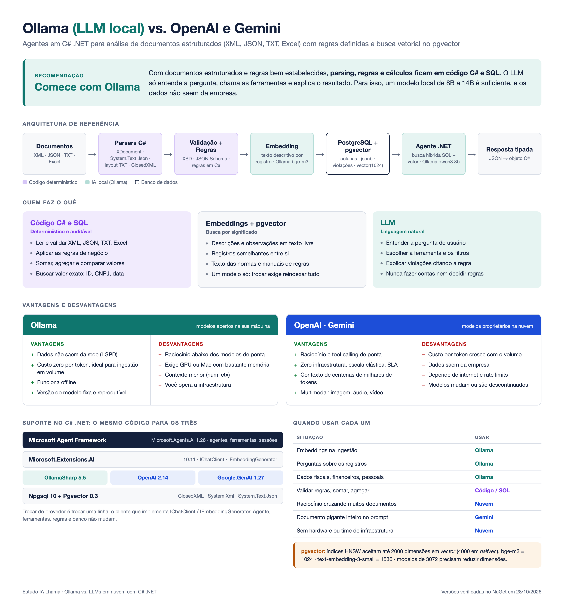

# Estudo IA Lhama

Estudo comparativo entre o Ollama (LLM local) e LLMs em nuvem (OpenAI, Gemini), com foco em agentes em C# .NET para análise de documentos estruturados (XML, JSON, TXT, Excel) com regras de negócio e busca vetorial no pgvector.



## Conteúdo

| Caminho | Descrição |
|---|---|
| [Estudo-Ollama-vs-LLMs-Nuvem-DotNet.md](Estudo-Ollama-vs-LLMs-Nuvem-DotNet.md) | Estudo completo: comparativo, vantagens e desvantagens, arquitetura com pgvector, suporte no .NET e quando usar cada um |
| [OllamaAgente/](OllamaAgente/) | Agente de análise de notas fiscais com Ollama, em DDD / Clean Architecture, com testes |
| [AgenteDemo/](AgenteDemo/) | Exemplo mínimo de agente que roda com Ollama, OpenAI ou Gemini trocando uma variável de ambiente |
| [assets/infografico.html](assets/infografico.html) | Fonte do infográfico (renderizado para PNG com o Chrome headless) |

## Início rápido

```bash
ollama serve
ollama pull qwen3:8b
cd OllamaAgente
dotnet test
dotnet run --project src/OllamaAgente.Cli -- --teste
```
